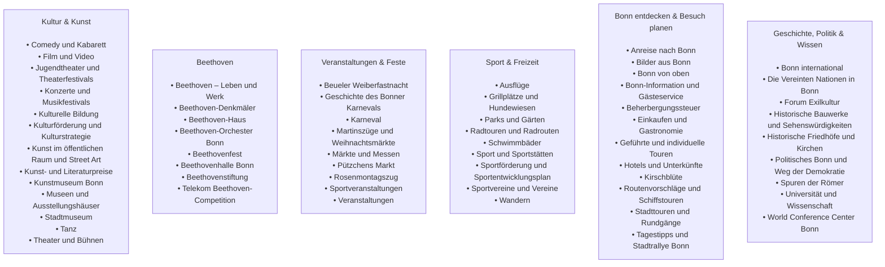

# Informationsarchitektur WS26/27: Ablage großer Dateien der EAs

## Aufgabe 3.2: Artefakte des Card Sortings

### Liste der 60 einzusortierenden Begriffe
todo

### Tabellarische Übersicht über die Ergebnisse
todo

Die Kategorien wurden für die Auswerdung teilweise verschmolzen/zusammengefasst, um leicht unterschiedliche Benennungen auszugleichen:

- Kultur = Kunst und Kultur + Kunst/Kultur + Kultur + Museen

- Tourismus = "Good to know" + Tourismus + Tourismus - Allgemein + Tourismus - Anfahrt und Unterkunft + Reise nach Bonn

- Sport und Freizeit = Sport & Freizeit + Sport/Aktivitäten + Sport/Bewegung + Freizeitangebote

- Veranstaltungen = Events + Veranstaltungen

Anmerkung zu den Teilnehmern: Auf Nachfrage wussten nur P1 + P4 von der Relevanz von Beethoven in Bonn (Geburtsstätte, etc.), was die eigene Kategorie erklärt (ist auf der Seite www.bonn.de auch so umgesetzt)

### Grafische Übersicht der Sortierung der Teilnehmer

```mermaid

flowchart TB

  subgraph P1["Teilnehmer P1"]
    direction TB
    P1_G1["Sport/Bewegung (9)<br/>Sportveranstaltungen<br/>Schwimmbäder<br/>Sport und Sportstätten<br/>Wandern<br/>Sportvereine und Vereine<br/>Parks und Gärten<br/>Radtouren und Radrouten<br/>Ausflüge<br/>Sportförderung und Sportentwicklungsplan"]
    P1_G2["Beethoven (8)<br/>Beethoven-Orchester Bonn<br/>Beethoven – Leben und Werk<br/>Beethoven-Denkmäler<br/>Telekom Beethoven-Competition<br/>Beethoven-Haus<br/>Beethovenfest<br/>Beethovenhalle Bonn<br/>Beethovenstiftung"]
    P1_G3["Shopping (3)<br/>Pützchens Markt<br/>Einkaufen und Gastronomie<br/>Märkte und Messen"]
    P1_G4["Reise nach Bonn (4)<br/>Hotels und Unterkünfte<br/>Anreise nach Bonn<br/>Bonn-Information und Gästeservice<br/>Beherbergungssteuer"]
    P1_G5["Bonn entdecken (9)<br/>Stadttouren und Rundgänge<br/>Bonn von oben<br/>Bonn international<br/>Geführte und individuelle Touren<br/>Tagestipps und Stadtrallye Bonn<br/>Routenvorschläge und Schiffstouren<br/>Grillplätze und Hundewiesen<br/>Kirschblüte<br/>Bilder aus Bonn"]
    P1_G6["Kultur &amp; Geschichte (23)<br/>Tanz<br/>Konzerte und Musikfestivals<br/>Jugendtheater und Theaterfestivals<br/>Museen und Ausstellungshäuser<br/>Martinszüge und Weihnachtsmärkte<br/>Geschichte des Bonner Karnevals<br/>Rosenmontagszug<br/>Kulturförderung und Kulturstrategie<br/>Veranstaltungen<br/>Kunstmuseum Bonn<br/>Spuren der Römer<br/>Kulturelle Bildung<br/>Kunst- und Literaturpreise<br/>Kunst im öffentlichen Raum und Street Art<br/>Film und Video<br/>Comedy und Kabarett<br/>Forum Exilkultur<br/>Karneval<br/>Stadtmuseum<br/>Beueler Weiberfastnacht<br/>Theater und Bühnen<br/>Historische Bauwerke und Sehenswürdigkeiten<br/>Historische Friedhöfe und Kirchen"]
    P1_G7["Politik &amp; Forschung (4)<br/>Die Vereinten Nationen in Bonn<br/>World Conference Center Bonn<br/>Politisches Bonn und Weg der Demokratie<br/>Universität und Wissenschaft"]
  end

  subgraph P2["Teilnehmer P2"]
    direction TB
    P2_G1["Unterhaltung (4)<br/>Konzerte und Musikfestivals<br/>Comedy und Kabarett<br/>Film und Video<br/>Beethoven-Orchester Bonn"]
    P2_G2["Kultur (11)<br/>Beethovenstiftung<br/>Beethoven – Leben und Werk<br/>Beethoven-Haus<br/>Kulturelle Bildung<br/>Beethovenhalle Bonn<br/>Theater und Bühnen<br/>Telekom Beethoven-Competition<br/>Kunst- und Literaturpreise<br/>Kulturförderung und Kulturstrategie<br/>Kunst im öffentlichen Raum und Street Art<br/>Jugendtheater und Theaterfestivals"]
    P2_G3["Sport &amp; Freizeit (9)<br/>Radtouren und Radrouten<br/>Ausflüge<br/>Grillplätze und Hundewiesen<br/>Tanz<br/>Sportveranstaltungen<br/>Sport und Sportstätten<br/>Sportvereine und Vereine<br/>Schwimmbäder<br/>Sportförderung und Sportentwicklungsplan"]
    P2_G4["Lokales (4)<br/>Bonn von oben<br/>Bilder aus Bonn<br/>Universität und Wissenschaft<br/>Forum Exilkultur"]
    P2_G5["Politisches &amp; Rechtliches (5)<br/>Politisches Bonn und Weg der Demokratie<br/>Beherbergungssteuer<br/>Die Vereinten Nationen in Bonn<br/>Bonn international<br/>World Conference Center Bonn"]
    P2_G6["Natur (2)<br/>Parks und Gärten<br/>Kirschblüte"]
    P2_G7["Historisches (5)<br/>Geschichte des Bonner Karnevals<br/>Historische Friedhöfe und Kirchen<br/>Beethoven-Denkmäler<br/>Spuren der Römer<br/>Historische Bauwerke und Sehenswürdigkeiten"]
    P2_G8["Tourismus (12)<br/>Einkaufen und Gastronomie<br/>Routenvorschläge und Schiffstouren<br/>Hotels und Unterkünfte<br/>Geführte und individuelle Touren<br/>Anreise nach Bonn<br/>Stadttouren und Rundgänge<br/>Wandern<br/>Tagestipps und Stadtrallye Bonn<br/>Bonn-Information und Gästeservice<br/>Museen und Ausstellungshäuser<br/>Stadtmuseum<br/>Kunstmuseum Bonn"]
    P2_G9["Veranstaltungen (8)<br/>Pützchens Markt<br/>Martinszüge und Weihnachtsmärkte<br/>Märkte und Messen<br/>Karneval<br/>Rosenmontagszug<br/>Beueler Weiberfastnacht<br/>Veranstaltungen<br/>Beethovenfest"]
  end

  subgraph P3["Teilnehmer P3"]
    direction TB
    P3_G1["Geschichte (2)<br/>Spuren der Römer<br/>Geschichte des Bonner Karnevals"]
    P3_G2["Kunst und Kultur (7)<br/>Kunst im öffentlichen Raum und Street Art<br/>Kunst- und Literaturpreise<br/>Kulturförderung und Kulturstrategie<br/>Comedy und Kabarett<br/>Tanz<br/>Beethoven – Leben und Werk<br/>Kirschblüte"]
    P3_G3["Bildung und Foren (5)<br/>Kulturelle Bildung<br/>Universität und Wissenschaft<br/>Film und Video<br/>Forum Exilkultur<br/>Beethovenstiftung"]
    P3_G4["Events (10)<br/>Jugendtheater und Theaterfestivals<br/>Konzerte und Musikfestivals<br/>Telekom Beethoven-Competition<br/>Beethovenfest<br/>Veranstaltungen<br/>Rosenmontagszug<br/>Beueler Weiberfastnacht<br/>Sportveranstaltungen<br/>Karneval<br/>Martinszüge und Weihnachtsmärkte"]
    P3_G5["Locations (6)<br/>Beethovenhalle Bonn<br/>World Conference Center Bonn<br/>Beethoven-Orchester Bonn<br/>Beethoven-Haus<br/>Theater und Bühnen<br/>Kunstmuseum Bonn"]
    P3_G6["Städtisches (7)<br/>Die Vereinten Nationen in Bonn<br/>Bonn international<br/>Sportförderung und Sportentwicklungsplan<br/>Politisches Bonn und Weg der Demokratie<br/>Bonn von oben<br/>Bilder aus Bonn<br/>Einkaufen und Gastronomie"]
    P3_G7["Museen (2)<br/>Museen und Ausstellungshäuser<br/>Stadtmuseum"]
    P3_G8["Historische Bauwerke &amp;Denkmäler (3)<br/>Beethoven-Denkmäler<br/>Historische Friedhöfe und Kirchen<br/>Historische Bauwerke und Sehenswürdigkeiten"]
    P3_G9["Tourismus - Anfahrt und Unterkunft (2)<br/>Hotels und Unterkünfte<br/>Anreise nach Bonn"]
    P3_G10["Tourismus - Allgemein (2)<br/>Bonn-Information und Gästeservice<br/>Beherbergungssteuer"]
    P3_G11["Freizeitangebote (14)<br/>Sportvereine und Vereine<br/>Wandern<br/>Grillplätze und Hundewiesen<br/>Radtouren und Radrouten<br/>Routenvorschläge und Schiffstouren<br/>Geführte und individuelle Touren<br/>Ausflüge<br/>Tagestipps und Stadtrallye Bonn<br/>Parks und Gärten<br/>Schwimmbäder<br/>Sport und Sportstätten<br/>Stadttouren und Rundgänge<br/>Märkte und Messen<br/>Pützchens Markt"]
  end

  subgraph P4["Teilnehmer P4"]
    direction TB
    P4_G1["Beethoven (8)<br/>Telekom Beethoven-Competition<br/>Beethovenstiftung<br/>Beethoven – Leben und Werk<br/>Beethoven-Haus<br/>Beethoven-Orchester Bonn<br/>Beethoven-Denkmäler<br/>Beethovenhalle Bonn<br/>Beethovenfest"]
    P4_G2["Karneval (4)<br/>Karneval<br/>Geschichte des Bonner Karnevals<br/>Rosenmontagszug<br/>Beueler Weiberfastnacht"]
    P4_G3["Sport/Aktivitäten (9)<br/>Sportveranstaltungen<br/>Tanz<br/>Sportvereine und Vereine<br/>Radtouren und Radrouten<br/>Schwimmbäder<br/>Sportförderung und Sportentwicklungsplan<br/>Wandern<br/>Sport und Sportstätten<br/>Geführte und individuelle Touren"]
    P4_G4["Kunst und Kultur (14)<br/>Theater und Bühnen<br/>Jugendtheater und Theaterfestivals<br/>Kunst im öffentlichen Raum und Street Art<br/>Kunst- und Literaturpreise<br/>Kunstmuseum Bonn<br/>Stadtmuseum<br/>Comedy und Kabarett<br/>Konzerte und Musikfestivals<br/>Museen und Ausstellungshäuser<br/>Kulturförderung und Kulturstrategie<br/>Kulturelle Bildung<br/>Bilder aus Bonn<br/>Kirschblüte<br/>Film und Video"]
    P4_G5["Geschichte (8)<br/>Historische Bauwerke und Sehenswürdigkeiten<br/>Die Vereinten Nationen in Bonn<br/>Politisches Bonn und Weg der Demokratie<br/>Historische Friedhöfe und Kirchen<br/>World Conference Center Bonn<br/>Spuren der Römer<br/>Forum Exilkultur<br/>Bonn international"]
    P4_G6["Umgebung (14)<br/>Parks und Gärten<br/>Grillplätze und Hundewiesen<br/>Universität und Wissenschaft<br/>Tagestipps und Stadtrallye Bonn<br/>Routenvorschläge und Schiffstouren<br/>Pützchens Markt<br/>Einkaufen und Gastronomie<br/>Hotels und Unterkünfte<br/>Ausflüge<br/>Märkte und Messen<br/>Stadttouren und Rundgänge<br/>Martinszüge und Weihnachtsmärkte<br/>Veranstaltungen<br/>Bonn von oben"]
    P4_G7["&quot;Good to know&quot; (3)<br/>Beherbergungssteuer<br/>Anreise nach Bonn<br/>Bonn-Information und Gästeservice"]
  end

  classDef group1 fill:#E8F0FE,stroke:#6489C6,stroke-width:1.5px,color:#243B5A;
  classDef group2 fill:#EAF7F0,stroke:#69A88A,stroke-width:1.5px,color:#234B38;
  classDef group3 fill:#FFF3E5,stroke:#D69A52,stroke-width:1.5px,color:#68451F;
  classDef group4 fill:#F5ECFA,stroke:#A17AB8,stroke-width:1.5px,color:#503766;

  class P1_G1,P1_G2,P1_G3,P1_G4,P1_G5,P1_G6,P1_G7 group1;
  class P2_G1,P2_G2,P2_G3,P2_G4,P2_G5,P2_G6,P2_G7,P2_G8,P2_G9 group2;
  class P3_G1,P3_G2,P3_G3,P3_G4,P3_G5,P3_G6,P3_G7,P3_G8,P3_G9,P3_G10,P3_G11 group3;
  class P4_G1,P4_G2,P4_G3,P4_G4,P4_G5,P4_G6,P4_G7 group4;

  style P1 fill:#F4F7FC,stroke:#AAB8CC,stroke-width:2px,color:#243B5A
  style P2 fill:#F2FAF5,stroke:#9BBEAA,stroke-width:2px,color:#234B38
  style P3 fill:#FFFAF3,stroke:#D8B98F,stroke-width:2px,color:#68451F
  style P4 fill:#FAF6FC,stroke:#B9A2C8,stroke-width:2px,color:#503766

```

### Neue Konzipierung der Kategorisierung

## Aufgabe 4: Thesaurus für ausgewählte Online-Dienste der Stadt Bonn

```mermaid
flowchart TB

  subgraph A["Meldewesen"]
    M["`**Meldewesen**`"]
    W["`**Wohnsitz**`"]
    AM["`**Anmeldung nach dem Meldegesetz**`"]
    UM["`**Ummeldung nach dem Meldegesetz**`"]
    AB["`**Abmeldung nach dem Meldegesetz**`"]
    HW["`**Hauptwohnsitz**`"]
    NW["`**Nebenwohnsitz**`"]
    MB["`**Meldebescheinigung**`"]
    MR["`**Melderegister**`"]
    MRA["`**Melderegisterauskunft**`"]
    OAF["`**Online-Ausweisfunktion**`"]
    PA["`**Personalausweis**`"]
    U["`**Umzug**`"]
    Z["`**Zuzug**`"]
    WG["`**Wegzug**`"]

    WA["Wohnsitz anmelden"]
    WoA["Wohnung anmelden"]
    SA["sich anmelden"]
    AM1["Anmeldung beim Einwohnermeldeamt"]
    AM3["neue Adresse"]
    AM4["Adresse anmelden"]
    AM5["Anmeldung nach Umzug"]

    WU["Wohnsitz ummelden"]
    UM1["Adresse ummelden"]
    UM2["Wohnung ummelden"]
    UM3["Adressänderung"]
    UM5["Umzug beim Bürgeramt melden"]

    WAB["Wohnsitz abmelden"]
    AB1["Wohnung abmelden"]
    AB2["Abmeldung beim Einwohnermeldeamt"]
    AB3["aus Deutschland abmelden"]

    MB1["Meldebestätigung"]
    MB2["Wohnsitzbescheinigung"]
    MB3["Bescheinigung vom Einwohnermeldeamt"]

    MRA1["Meldeauskunft"]
    MRA2["Einwohnermeldeauskunft"]

    PA1["Perso"]
    OAF1["eID-Funktion"]
    OAF2["Online-Ausweis"]
  end

  subgraph C["Eigentum und Unterstützung"]
    WGELD["`**Wohngeld**`"]
    MZ["`**Mietzuschuss**`"]
    LZ["`**Lastenzuschuss**`"]
    WBS["`**Wohnberechtigungsschein**`"]
    GW["`**Geförderte Wohnung**`"]
    SL["`**Sozialleistungen**`"]
    ZWS["`**Zweitwohnungssteuer**`"]
    ST["`**Steuer**`"]
    SE["`**Steuerermäßigung**`"]
    HST["`**Hundesteuer**`"]
    HH["`**Hundehaltung**`"]

    WBS1["WBS"]
    WBS2["Sozialwohnungsschein"]
    GW1["Sozialwohnung"]
    GW2["öffentlich geförderte Wohnung"]
    ZWS1["Zweitwohnsitzsteuer"]
    ZWS2["Nebenwohnsitzsteuer"]
    HA["Hund anmelden"]
    HSA["Hundesteuer anmelden"]
  end

  subgraph D["Aufenthalt und Einbürgerung"]
    AT["`**Aufenthaltstitel**`"]
    EB["`**Einbürgerung**`"]
    STA["`**Staatsangehörigkeit**`"]
    AE["`**Arbeitserlaubnis**`"]
    ABH["`**Ausländerbehörde**`"]

    AG["Aufenthaltsgenehmigung"]
    AT1["Aufenthaltserlaubnis"]
    EB1["deutsche Staatsangehörigkeit beantragen"]
    EB2["Deutscher werden"]
    EB3["deutsche Staatsbürgerschaft beantragen"]
    STA1["Staatsbürgerschaft"]
    AE1["Arbeiten in Deutschland"]
    ABH1["Ausländeramt"]
    ABH2["Amt für Migration"]
  end

  %% NT: Unterbegriff zeigt auf Oberbegriff
  AM -->|NT| M
  UM -->|NT| M
  AB -->|NT| M
  MB -->|NT| M
  MR -->|NT| M
  MRA -->|NT| MR
  HW -->|NT| W
  NW -->|NT| W
  OAF -->|NT| PA

  WGELD -->|NT| SL
  WBS -->|NT| SL
  MZ -->|NT| WGELD
  LZ -->|NT| WGELD
  ZWS -->|NT| ST
  HST -->|NT| ST
  SE -->|NT| ST

  %% UF: PT verweist auf Varianten
  AM -->|UF| WA
  AM -->|UF| WoA
  AM -->|UF| SA
  AM -->|UF| AM1
  AM -->|UF| AM3
  AM -->|UF| AM4
  AM -->|UF| AM5

  UM -->|UF| WU
  UM -->|UF| UM1
  UM -->|UF| UM2
  UM -->|UF| UM3
  UM -->|UF| UM5

  AB -->|UF| WAB
  AB -->|UF| AB1
  AB -->|UF| AB2
  AB -->|UF| AB3

  MB -->|UF| MB1
  MB -->|UF| MB2
  MB -->|UF| MB3

  MRA -->|UF| MRA1
  MRA -->|UF| MRA2
  PA -->|UF| PA1
  OAF -->|UF| OAF1
  OAF -->|UF| OAF2

  WBS -->|UF| WBS1
  WBS -->|UF| WBS2
  GW -->|UF| GW1
  GW -->|UF| GW2
  ZWS -->|UF| ZWS1
  ZWS -->|UF| ZWS2
  HST -->|UF| HA
  HST -->|UF| HSA

  AT -->|UF| AG
  AT -->|UF| AT1
  EB -->|UF| EB1
  EB -->|UF| EB2
  EB -->|UF| EB3
  STA -->|UF| STA1
  AE -->|UF| AE1
  ABH -->|UF| ABH1
  ABH -->|UF| ABH2

  %% RT: bidirektionale Beziehungen
  W <-->|RT| AM
  W <-->|RT| AT
  UM <-->|RT| AM
  AB <-->|RT| AM
  W <-->|RT| MB
  W <-->|RT| ZWS
  NW <-->|RT| ZWS
  U <-->|RT| UM
  Z <-->|RT| AM
  WG <-->|RT| AB
  MB <-->|RT| MRA
  PA <-->|RT| M
  OAF <-->|RT| PA

  WBS <-->|RT| GW
  WGELD <-->|RT| GW
  SL <-->|RT| WGELD
  HH <-->|RT| HST

  AT <-->|RT| EB
  AT <-->|RT| STA
  AE <-->|RT| AT
  ABH <-->|RT| AT
  EB <-->|RT| PA
  EB <-->|RT| STA

  style A fill:#F4F8FF
  style C fill:#F4F8FF
  style D fill:#F4F8FF

  classDef PT stroke-width:3px
  class M,W,AM,UM,AB,HW,NW,MB,MR,MRA,OAF,PA,U,Z,WG,WGELD,MZ,LZ,WBS,GW,SL,ZWS,ST,SE,HST,HH,AT,EB,STA,AE,ABH PT
```

