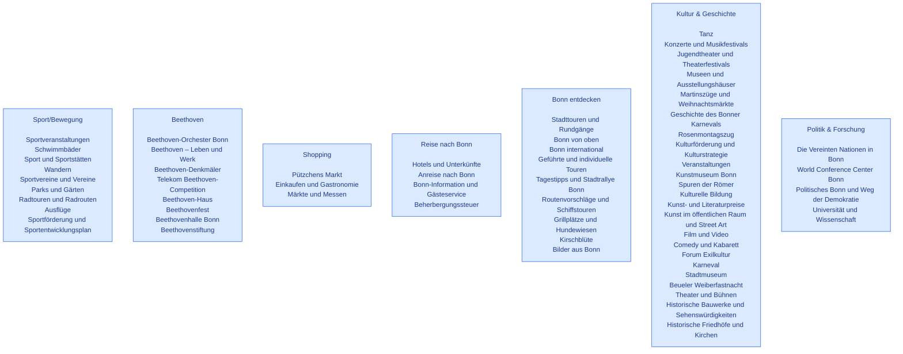
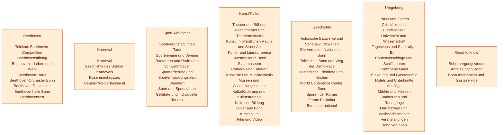
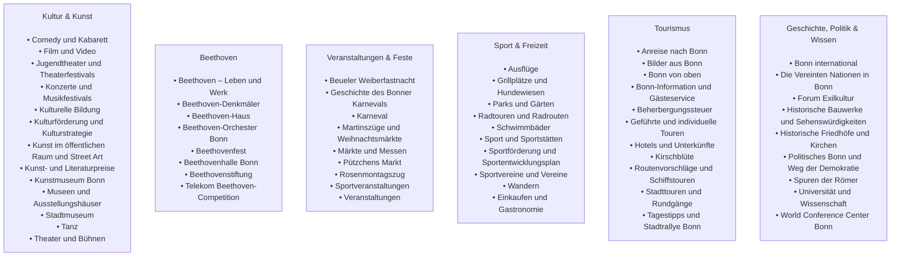

# Informationsarchitektur WS26/27: Ablage großer Dateien der EAs

## Aufgabe 3.2: Artefakte des Card Sortings

### Liste der 60 einzusortierenden Begriffe
|||||||
|---|---|---|---|---|---|
| World Conference Center Bonn | Politisches Bonn und Weg der Demokratie | Die Vereinten Nationen in Bonn | Bonn international | Hotels und Unterkünfte | Anreise nach Bonn |
| Bilder aus Bonn | Beherbergungssteuer | Wandern | Einkaufen und Gastronomie | Radtouren und Radrouten | Stadttouren und Rundgänge |
| Ausflüge | Routenvorschläge und Schiffstouren | Tagestipps und Stadtrallye Bonn | Bonn-Information und Gästeservice | Beethoven-Denkmäler | Bonn von oben |
| Stadtmuseum | Geführte und individuelle Touren | Parks und Gärten | Pützchens Markt | Historische Bauwerke und Sehenswürdigkeiten | Kirschblüte |
| Historische Friedhöfe und Kirchen | Kunst im öffentlichen Raum und Street Art | Grillplätze und Hundewiesen | Sportveranstaltungen | Telekom Beethoven-Competition | Beueler Weiberfastnacht |
| Veranstaltungen | Rosenmontagszug | Märkte und Messen | Beethovenfest | Theater und Bühnen | Jugendtheater und Theaterfestivals |
| Karneval | Konzerte und Musikfestivals | Martinszüge und Weihnachtsmärkte | Beethovenstiftung | Beethoven-Orchester Bonn | Beethovenhalle Bonn |
| Beethoven – Leben und Werk | Beethoven-Haus | Museen und Ausstellungshäuser | Kulturförderung und Kulturstrategie | Tanz | Kunst- und Literaturpreise |
| Spuren der Römer | Kulturelle Bildung | Geschichte des Bonner Karnevals | Comedy und Kabarett | Kunstmuseum Bonn | Forum Exilkultur |
| Film und Video | Universität und Wissenschaft | Sport und Sportstätten | Sportförderung und Sportentwicklungsplan | Sportvereine und Vereine | Schwimmbäder |

### Grafische Übersicht der Sortierung der Teilnehmer

Teilnehmer 1:

Teilnehmer 2:

```mermaid
flowchart LR
    A["Unterhaltung<br/><br/>Konzerte und Musikfestivals<br/>Comedy und Kabarett<br/>Film und Video<br/>Beethoven-Orchester Bonn"]
    B["Kultur<br/><br/>Beethovenstiftung<br/>Beethoven – Leben und Werk<br/>Beethoven-Haus<br/>Kulturelle Bildung<br/>Beethovenhalle Bonn<br/>Theater und Bühnen<br/>Telekom Beethoven-Competition<br/>Kunst- und Literaturpreise<br/>Kulturförderung und Kulturstrategie<br/>Kunst im öffentlichen Raum und Street Art<br/>Jugendtheater und Theaterfestivals"]
    C["Sport & Freizeit<br/><br/>Radtouren und Radrouten<br/>Ausflüge<br/>Grillplätze und Hundewiesen<br/>Tanz<br/>Sportveranstaltungen<br/>Sport und Sportstätten<br/>Sportvereine und Vereine<br/>Schwimmbäder<br/>Sportförderung und Sportentwicklungsplan"]
    D["Lokales<br/><br/>Bonn von oben<br/>Bilder aus Bonn<br/>Universität und Wissenschaft<br/>Forum Exilkultur"]
    E["Politisches & Rechtliches<br/><br/>Politisches Bonn und Weg der Demokratie<br/>Beherbergungssteuer<br/>Die Vereinten Nationen in Bonn<br/>Bonn international<br/>World Conference Center Bonn"]
    F["Natur<br/><br/>Parks und Gärten<br/>Kirschblüte"]
    G["Historisches<br/><br/>Geschichte des Bonner Karnevals<br/>Historische Friedhöfe und Kirchen<br/>Beethoven-Denkmäler<br/>Spuren der Römer<br/>Historische Bauwerke und Sehenswürdigkeiten"]
    H["Tourismus<br/><br/>Einkaufen und Gastronomie<br/>Routenvorschläge und Schiffstouren<br/>Hotels und Unterkünfte<br/>Geführte und individuelle Touren<br/>Anreise nach Bonn<br/>Stadttouren und Rundgänge<br/>Wandern<br/>Tagestipps und Stadtrallye Bonn<br/>Bonn-Information und Gästeservice<br/>Museen und Ausstellungshäuser<br/>Stadtmuseum<br/>Kunstmuseum Bonn"]
    I["Veranstaltungen<br/><br/>Pützchens Markt<br/>Martinszüge und Weihnachtsmärkte<br/>Märkte und Messen<br/>Karneval<br/>Rosenmontagszug<br/>Beueler Weiberfastnacht<br/>Veranstaltungen<br/>Beethovenfest"]

    A ~~~ B ~~~ C ~~~ D ~~~ E ~~~ F ~~~ G ~~~ H ~~~ I

    style A fill:#dcfce7,stroke:#16a34a,color:#14532d
    style B fill:#dcfce7,stroke:#16a34a,color:#14532d
    style C fill:#dcfce7,stroke:#16a34a,color:#14532d
    style D fill:#dcfce7,stroke:#16a34a,color:#14532d
    style E fill:#dcfce7,stroke:#16a34a,color:#14532d
    style F fill:#dcfce7,stroke:#16a34a,color:#14532d
    style G fill:#dcfce7,stroke:#16a34a,color:#14532d
    style H fill:#dcfce7,stroke:#16a34a,color:#14532d
    style I fill:#dcfce7,stroke:#16a34a,color:#14532d
    linkStyle default stroke:transparent,fill:none
```

Teilnehmer 3:

```mermaid
flowchart LR
    A["Geschichte<br/><br/>Spuren der Römer<br/>Geschichte des Bonner Karnevals"]
    B["Kunst und Kultur<br/><br/>Kunst im öffentlichen Raum und Street Art<br/>Kunst- und Literaturpreise<br/>Kulturförderung und Kulturstrategie<br/>Comedy und Kabarett<br/>Tanz<br/>Beethoven – Leben und Werk<br/>Kirschblüte"]
    C["Bildung und Foren<br/><br/>Kulturelle Bildung<br/>Universität und Wissenschaft<br/>Film und Video<br/>Forum Exilkultur<br/>Beethovenstiftung"]
    D["Events<br/><br/>Jugendtheater und Theaterfestivals<br/>Konzerte und Musikfestivals<br/>Telekom Beethoven-Competition<br/>Beethovenfest<br/>Veranstaltungen<br/>Rosenmontagszug<br/>Beueler Weiberfastnacht<br/>Sportveranstaltungen<br/>Karneval<br/>Martinszüge und Weihnachtsmärkte"]
    E["Locations<br/><br/>Beethovenhalle Bonn<br/>World Conference Center Bonn<br/>Beethoven-Orchester Bonn<br/>Beethoven-Haus<br/>Theater und Bühnen<br/>Kunstmuseum Bonn"]
    F["Städtisches<br/><br/>Die Vereinten Nationen in Bonn<br/>Bonn international<br/>Sportförderung und Sportentwicklungsplan<br/>Politisches Bonn und Weg der Demokratie<br/>Bonn von oben<br/>Bilder aus Bonn<br/>Einkaufen und Gastronomie"]
    G["Museen<br/><br/>Museen und Ausstellungshäuser<br/>Stadtmuseum"]
    H["Historische Bauwerke & Denkmäler<br/><br/>Beethoven-Denkmäler<br/>Historische Friedhöfe und Kirchen<br/>Historische Bauwerke und Sehenswürdigkeiten"]
    I["Tourismus - Anfahrt und Unterkunft<br/><br/>Hotels und Unterkünfte<br/>Anreise nach Bonn"]
    J["Tourismus - Allgemein<br/><br/>Bonn-Information und Gästeservice<br/>Beherbergungssteuer"]
    K["Freizeitangebote<br/><br/>Sportvereine und Vereine<br/>Wandern<br/>Grillplätze und Hundewiesen<br/>Radtouren und Radrouten<br/>Routenvorschläge und Schiffstouren<br/>Geführte und individuelle Touren<br/>Ausflüge<br/>Tagestipps und Stadtrallye Bonn<br/>Parks und Gärten<br/>Schwimmbäder<br/>Sport und Sportstätten<br/>Stadttouren und Rundgänge<br/>Märkte und Messen<br/>Pützchens Markt"]

    A ~~~ B ~~~ C ~~~ D ~~~ E ~~~ F ~~~ G ~~~ H ~~~ I ~~~ J ~~~ K

    style A fill:#fce7f3,stroke:#db2777,color:#831843
    style B fill:#fce7f3,stroke:#db2777,color:#831843
    style C fill:#fce7f3,stroke:#db2777,color:#831843
    style D fill:#fce7f3,stroke:#db2777,color:#831843
    style E fill:#fce7f3,stroke:#db2777,color:#831843
    style F fill:#fce7f3,stroke:#db2777,color:#831843
    style G fill:#fce7f3,stroke:#db2777,color:#831843
    style H fill:#fce7f3,stroke:#db2777,color:#831843
    style I fill:#fce7f3,stroke:#db2777,color:#831843
    style J fill:#fce7f3,stroke:#db2777,color:#831843
    style K fill:#fce7f3,stroke:#db2777,color:#831843
    linkStyle default stroke:transparent,fill:none
```

Teilnehmer 4:

Teilnehmer 5:

```mermaid
flowchart LR
    A["Politik<br/><br/>World Conference Center Bonn<br/>Politisches Bonn und Weg der Demokratie<br/>Die Vereinten Nationen in Bonn<br/>Bonn international"]
    B["Reisen<br/><br/>Hotels und Unterkünfte<br/>Anreise nach Bonn<br/>Bilder aus Bonn<br/>Beherbergungssteuer<br/>Wandern<br/>Einkaufen und Gastronomie<br/>Radtouren und Radrouten<br/>Stadttouren und Rundgänge<br/>Ausflüge<br/>Routenvorschläge und Schiffstouren<br/>Tagestipps und Stadtrallye Bonn<br/>Bonn-Information und Gästeservice"]
    C["Sehenswürdigkeiten<br/><br/>Beethoven-Denkmäler<br/>Bonn von oben<br/>Stadtmuseum<br/>Geführte und individuelle Touren<br/>Parks und Gärten<br/>Pützchens Markt<br/>Historische Bauwerke und Sehenswürdigkeiten<br/>Kirschblüte<br/>Historische Friedhöfe und Kirchen<br/>Kunst im öffentlichen Raum und Street Art<br/>Grillplätze und Hundewiesen"]
    D["Veranstaltungen<br/><br/>Sportveranstaltungen<br/>Telekom Beethoven-Competition<br/>Beueler Weiberfastnacht<br/>Veranstaltungen<br/>Rosenmontagszug<br/>Märkte und Messen<br/>Beethovenfest<br/>Theater und Bühnen<br/>Jugendtheater und Theaterfestivals<br/>Karneval<br/>Konzerte und Musikfestivals<br/>Martinszüge und Weihnachtsmärkte"]
    E["Bethoven<br/><br/>Beethovenstiftung<br/>Beethoven-Orchester Bonn<br/>Beethovenhalle Bonn<br/>Beethoven – Leben und Werk<br/>Beethoven-Haus"]
    F["Kunst und Kultur<br/><br/>Museen und Ausstellungshäuser<br/>Kulturförderung und Kulturstrategie<br/>Tanz<br/>Kunst- und Literaturpreise<br/>Spuren der Römer<br/>Kulturelle Bildung<br/>Geschichte des Bonner Karnevals<br/>Comedy und Kabarett<br/>Kunstmuseum Bonn<br/>Forum Exilkultur<br/>Film und Video"]
    G["Bildung und Sport<br/><br/>Universität und Wissenschaft<br/>Sport und Sportstätten<br/>Sportförderung und Sportentwicklungsplan<br/>Sportvereine und Vereine<br/>Schwimmbäder"]

    A ~~~ B ~~~ C ~~~ D ~~~ E ~~~ F ~~~ G

    style A fill:#ede9fe,stroke:#7c3aed,color:#4c1d95
    style B fill:#ede9fe,stroke:#7c3aed,color:#4c1d95
    style C fill:#ede9fe,stroke:#7c3aed,color:#4c1d95
    style D fill:#ede9fe,stroke:#7c3aed,color:#4c1d95
    style E fill:#ede9fe,stroke:#7c3aed,color:#4c1d95
    style F fill:#ede9fe,stroke:#7c3aed,color:#4c1d95
    style G fill:#ede9fe,stroke:#7c3aed,color:#4c1d95
    linkStyle default stroke:transparent,fill:none
```

Die Kategorien wurden für die Auswerdung teilweise verschmolzen/zusammengefasst, um leicht unterschiedliche Benennungen auszugleichen:

- Kultur = Kunst und Kultur + Kunst/Kultur + Kultur + Museen

- Tourismus = "Good to know" + Tourismus + Tourismus - Allgemein + Tourismus - Anfahrt und Unterkunft + Reise nach Bonn

- Sport und Freizeit = Sport & Freizeit + Sport/Aktivitäten + Sport/Bewegung + Freizeitangebote

- Veranstaltungen = Events + Veranstaltungen

### Tabellarische Übersicht über die Bemerkungen der Teilnehmer

|  | Teilnehmer 1 | Teilnehmer 2 | Teilnehmer 3 | Teilnehmer 4 | Teilnehmer 5 |
|---|---|---|---|---|---|
| **Freitext-Feedback des Teilnehmers (zusammengefasst)** | Zu Beethoven: „Zu hohe Anzahl an spezifischen Begriffen, um die auch in 'Kultur' zu stecken, deswegen ganz eigene Kategorie.“ | Allgemein: „Das Zusammenfassen der Themen war schwierig aber nötig, damit einzelne Gruppen nicht zu klein werden (z. B. Forschung).“  Zu Museen/Kunst in der „Tourismus“-Kategorie vs. „Kultur“-Kategorie: „Als Tourist suchst du vielleicht eher nach konkreten Museen, die du dir angucken kannst und nicht nach allgemeinen Kultur-Infos.“ | Allgemein: „Mein Ansatz war: 'Wer schaut gerade da drauf und was hilft der Person dabei?', und somit sind z. B. alle Freizeit-Sachen beisammen und nicht unter Tourismus Touren und Parks dann unter was anderem, denn wenn man Freizeit hat, als Besucher oder als Anwohner, sucht man das gleiche.“  Zu Beethoven: „Es gab viele Beethoven-Begriffe, deswegen habe ich das zu einer eigenen Kategorie gemacht.“ | Zu Umgebung: „Kategorie nach dem Motto 'Was es in Bonn gibt'; Schwimmbäder hätte ich auch da rein machen können, aber das passt halt eher zu Sport, weil es keine 'wichtige Location' ist, sondern etwas, wo du für eine Aktivität hingehst, und was wahrscheinlich jede Stadt hat. Und sonst wäre Umgebung zu groß geworden.“  Zu „Good to know“: „Das ist für Anwohner eher nicht so wichtig.“  Zu Geschichte: „Kann man ggf. unter Geschichte und Politik zusammenfassen.“ | Allgemein: „Bei einigen Begriffen war es schwer, sie eindeutig zuzuordnen. Kirschblüten fand ich schwer.“  Allgemein: „Recht einfache Einteilung in Reisen, Politik, Kunst und Kultur, Sehenswürdigkeiten und Veranstaltungen. Weil es so viel davon gibt, habe ich die Beethoven-Sachen in eine eigene Kategorie getan.“  Zu Bildung und Sport: „Ich bin nicht zufrieden mit der Kategorie, aber ich wusste nicht, wo ich Schwimmen und Wissenschaft sonst unterbringen sollte.“ |
| **Eigene Anmerkungen** | Stark zusammengefasst, aber „Kultur & Geschichte“ sehr groß. | „Natur“ sehr kleine Kategorie, eher aufteilen. | TN mit den meisten Kategorien; thematische Überschneidung zwischen Kunst und Kultur + Museen sowie den beiden Tourismus-Kategorien. | Aufteilen der Kategorie „Bildung und Sport“. | „Locations“ einzige nicht-themenbezogene Kategorie; Inhalte wären auch in Themen wie „Kunst und Kultur“ einsortierbar.  „Good to know“ – ungenaue Benennung, entspricht von Begriffen her „Tourismus“-Kategorie. |

### Neue Konzipierung der Kategorisierung

## Aufgabe 4: Thesaurus für ausgewählte Online-Dienste der Stadt Bonn

```mermaid
flowchart TB

  subgraph A["Meldewesen"]
    M["`**Meldewesen**`"]
    W["`**Wohnsitz**`"]
    AM["`**Anmeldung nach dem Meldegesetz**`"]
    UM["`**Ummeldung nach dem Meldegesetz**`"]
    AB["`**Abmeldung nach dem Meldegesetz**`"]
    HW["`**Hauptwohnsitz**`"]
    NW["`**Nebenwohnsitz**`"]
    MB["`**Meldebescheinigung**`"]
    MR["`**Melderegister**`"]
    MRA["`**Melderegisterauskunft**`"]
    OAF["`**Online-Ausweisfunktion**`"]
    PA["`**Personalausweis**`"]
    U["`**Umzug**`"]
    Z["`**Zuzug**`"]
    WG["`**Wegzug**`"]

    WA["Wohnsitz anmelden"]
    WoA["Wohnung anmelden"]
    SA["sich anmelden"]
    AM1["Anmeldung beim Einwohnermeldeamt"]
    AM3["neue Adresse"]
    AM4["Adresse anmelden"]
    AM5["Anmeldung nach Umzug"]

    WU["Wohnsitz ummelden"]
    UM1["Adresse ummelden"]
    UM2["Wohnung ummelden"]
    UM3["Adressänderung"]
    UM5["Umzug beim Bürgeramt melden"]

    WAB["Wohnsitz abmelden"]
    AB1["Wohnung abmelden"]
    AB2["Abmeldung beim Einwohnermeldeamt"]
    AB3["aus Deutschland abmelden"]

    MB1["Meldebestätigung"]
    MB2["Wohnsitzbescheinigung"]
    MB3["Bescheinigung vom Einwohnermeldeamt"]

    MRA1["Meldeauskunft"]
    MRA2["Einwohnermeldeauskunft"]

    PA1["Perso"]
    OAF1["eID-Funktion"]
    OAF2["Online-Ausweis"]
  end

  subgraph C["Eigentum und Unterstützung"]
    WGELD["`**Wohngeld**`"]
    MZ["`**Mietzuschuss**`"]
    LZ["`**Lastenzuschuss**`"]
    WBS["`**Wohnberechtigungsschein**`"]
    GW["`**Geförderte Wohnung**`"]
    SL["`**Sozialleistungen**`"]
    ZWS["`**Zweitwohnungssteuer**`"]
    ST["`**Steuer**`"]
    SE["`**Steuerermäßigung**`"]
    HST["`**Hundesteuer**`"]
    HH["`**Hundehaltung**`"]

    WBS1["WBS"]
    WBS2["Sozialwohnungsschein"]
    GW1["Sozialwohnung"]
    GW2["öffentlich geförderte Wohnung"]
    ZWS1["Zweitwohnsitzsteuer"]
    ZWS2["Nebenwohnsitzsteuer"]
    HA["Hund anmelden"]
    HSA["Hundesteuer anmelden"]
  end

  subgraph D["Aufenthalt und Einbürgerung"]
    AT["`**Aufenthaltstitel**`"]
    EB["`**Einbürgerung**`"]
    STA["`**Staatsangehörigkeit**`"]
    AE["`**Arbeitserlaubnis**`"]
    ABH["`**Ausländerbehörde**`"]

    AG["Aufenthaltsgenehmigung"]
    AT1["Aufenthaltserlaubnis"]
    EB1["deutsche Staatsangehörigkeit beantragen"]
    EB2["Deutscher werden"]
    EB3["deutsche Staatsbürgerschaft beantragen"]
    STA1["Staatsbürgerschaft"]
    AE1["Arbeiten in Deutschland"]
    ABH1["Ausländeramt"]
    ABH2["Amt für Migration"]
  end

  %% NT: Unterbegriff zeigt auf Oberbegriff
  AM -->|NT| M
  UM -->|NT| M
  AB -->|NT| M
  MB -->|NT| M
  MR -->|NT| M
  MRA -->|NT| MR
  HW -->|NT| W
  NW -->|NT| W
  OAF -->|NT| PA

  WGELD -->|NT| SL
  WBS -->|NT| SL
  MZ -->|NT| WGELD
  LZ -->|NT| WGELD
  ZWS -->|NT| ST
  HST -->|NT| ST
  SE -->|NT| ST

  %% UF: PT verweist auf Varianten
  AM -->|UF| WA
  AM -->|UF| WoA
  AM -->|UF| SA
  AM -->|UF| AM1
  AM -->|UF| AM3
  AM -->|UF| AM4
  AM -->|UF| AM5

  UM -->|UF| WU
  UM -->|UF| UM1
  UM -->|UF| UM2
  UM -->|UF| UM3
  UM -->|UF| UM5

  AB -->|UF| WAB
  AB -->|UF| AB1
  AB -->|UF| AB2
  AB -->|UF| AB3

  MB -->|UF| MB1
  MB -->|UF| MB2
  MB -->|UF| MB3

  MRA -->|UF| MRA1
  MRA -->|UF| MRA2
  PA -->|UF| PA1
  OAF -->|UF| OAF1
  OAF -->|UF| OAF2

  WBS -->|UF| WBS1
  WBS -->|UF| WBS2
  GW -->|UF| GW1
  GW -->|UF| GW2
  ZWS -->|UF| ZWS1
  ZWS -->|UF| ZWS2
  HST -->|UF| HA
  HST -->|UF| HSA

  AT -->|UF| AG
  AT -->|UF| AT1
  EB -->|UF| EB1
  EB -->|UF| EB2
  EB -->|UF| EB3
  STA -->|UF| STA1
  AE -->|UF| AE1
  ABH -->|UF| ABH1
  ABH -->|UF| ABH2

  %% RT: bidirektionale Beziehungen
  W <-->|RT| AM
  W <-->|RT| AT
  UM <-->|RT| AM
  AB <-->|RT| AM
  W <-->|RT| MB
  W <-->|RT| ZWS
  NW <-->|RT| ZWS
  U <-->|RT| UM
  Z <-->|RT| AM
  WG <-->|RT| AB
  MB <-->|RT| MRA
  PA <-->|RT| M
  OAF <-->|RT| PA

  WBS <-->|RT| GW
  WGELD <-->|RT| GW
  SL <-->|RT| WGELD
  HH <-->|RT| HST

  AT <-->|RT| EB
  AT <-->|RT| STA
  AE <-->|RT| AT
  ABH <-->|RT| AT
  EB <-->|RT| PA
  EB <-->|RT| STA

  style A fill:#F4F8FF
  style C fill:#F4F8FF
  style D fill:#F4F8FF

  classDef PT stroke-width:3px
  class M,W,AM,UM,AB,HW,NW,MB,MR,MRA,OAF,PA,U,Z,WG,WGELD,MZ,LZ,WBS,GW,SL,ZWS,ST,SE,HST,HH,AT,EB,STA,AE,ABH PT
```

